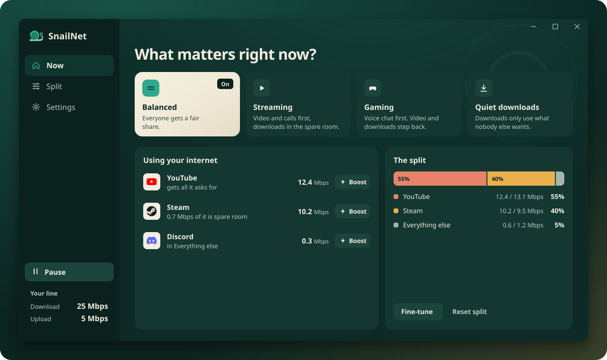

<p align="center">
  
</p>

<h1 align="center">SnailNet</h1>

<p align="center"><b>Put the bandwidth hogs in the slow lane.</b></p>

<p align="center">
  Share your Windows PC's internet between apps and websites by percentage,<br>
  so the game download and YouTube both keep going.
</p>

<p align="center">
  <a href="https://stergiosf.github.io/SnailNet/">Website</a> ·
  <a href="https://github.com/StergiosF/SnailNet/releases">Download</a> ·
  <a href="#using-snailnet">How to use it</a> ·
  <a href="#help-my-internet-broke">Help</a> ·
  <a href="#privacy">Privacy</a>
</p>

<p align="center">
  
  
  
</p>



## Why SnailNet

A game download starts and takes the whole line. The video you're
watching stops to buffer, the call breaks up, and ping jumps in the
middle of a match. Router settings are hard to find, and most bandwidth
tools make you type limits in KB/s and do the arithmetic yourself.

SnailNet lets you say it the way you think it: *the download gets 40%,
YouTube gets 60%*. It does the rest, on your PC, with no account and
nothing sent anywhere.

## What it does

- **Splits your connection by percentage.** Give each app or website a
  slice of the line. Everything you haven't named shares the rest, and
  always keeps at least 5%.
- **A slice is a guarantee, never a cage.** While everyone is busy, each
  gets its slice. What one doesn't use goes to whoever needs it, so none
  of your connection is wasted.
- **Works on websites, in any browser.** A rule for YouTube, Twitch or
  Netflix applies in every browser and comes before the browser's own
  slice.
- **Lets games and calls go first.** The app in front gets its traffic out
  first, a game keeps that while it runs, and Boost lets one app go first
  for an hour, four hours or until you stop it.
- **Keeps ping low.** It sends slightly below your line speed, so the
  queue stays on your PC instead of in your router, and follows your line
  as it gets faster or slower.
- **Switches whole setups in one click.** Four modes, plus your own copies
  of them.
- **Steps aside rather than break your internet.** If anything goes
  wrong, your traffic flows straight through. Pause stops everything in
  one click.


## Download and install

1. **Download [`SnailNet-setup.exe`](https://github.com/StergiosF/SnailNet/releases/latest/download/SnailNet-setup.exe)**
   from the [latest release](https://github.com/StergiosF/SnailNet/releases/latest).
   To hear about new ones, watch this repository (Watch → Custom →
   Releases).
2. **Run it.** The installer isn't code-signed yet, so Windows may show
   *"Windows protected your PC"*. Choose **More info**, then **Run
   anyway**. Windows asks for administrator permission once, to install
   the SnailNet service and the WinDivert driver.
3. **Tell it your speed.** On first start SnailNet offers to measure your
   connection (about 20 seconds, with Cloudflare's speed test), or you can
   type the speeds a speed test shows. Until it knows your speed, it only
   watches.

That's it: SnailNet starts sharing your connection, starts with Windows,
and sits in the tray.

**Needs:** Windows 10 or 11, 64-bit (x64). Not available for macOS,
Linux or ARM PCs.

## Using SnailNet

**The tray.** Click the snail in the notification area for the quick
panel: who is using the internet right now, the four modes, each slice
with − and +, and Pause.

**Now** (the main window's first page) answers *what matters right now?*

- Pick a **mode**: the whole split changes at once.
- **Using your internet** lists every app and website moving data, how
  fast, and how it's doing ("gets all it asks for", "using its whole
  slice, wants more"). **Boost** lets one of them go first for a while:
  it gets at least half your line, then everything goes back by itself.
- **The split** shows each slice as a bar. **Fine-tune** opens the Split
  page; **Reset split** puts the mode back how it started.

**Split** is where you shape it:

- **−** and **+** make a slice smaller or bigger, 5% at a time.
- **Add a slice** for an app or a website (search by name).
- Open a slice for more: **Goes first** (High, Normal, Low priority),
  **Only when the line is free** (it waits until nobody else needs the
  line), a **speed limit** in Mbps or %, or **Remove**.
- **Block** an app from its Boost menu if it shouldn't use the internet
  at all.

| Mode | What it does |
| --- | --- |
| **Balanced** | Every app gets a fair share. |
| **Streaming** | Videos and calls stay smooth. Downloads wait. |
| **Gaming** | Your game and voice chat come first. |
| **Quiet downloads** | Downloads never slow anything else down. |

Press **Ctrl+Alt+S** anywhere to step to the next mode (change the keys
in Settings → Windows). With *Switch to Gaming while I play* on, SnailNet
switches to Gaming when a game starts and back when it closes.

**Settings** is grouped the way you'd look for things: your internet
(speed, **Measure** or **Change**, the last speed test, other networks),
games and the app you're using, new apps, Windows (start with Windows,
the hotkey), version and updates, and starting over. When a new version
is out, an **Update** button appears in the side bar; one click installs
it.

### The words SnailNet uses

| Word | Means |
| --- | --- |
| **Slice** | An app's or website's share of your line, in percent. |
| **Everything else** | All the apps you haven't given a slice. It always keeps at least 5%. |
| **Goes first** | Its traffic is sent ahead of the rest, so it stays quick. It never makes the slice bigger. |
| **Only when the line is free** | It uses the line only when nobody else wants it. |
| **Boost** | Let one app go first for a while. |
| **Your line** | How fast your connection is, down and up. SnailNet shares out exactly that. |

## Questions

**If I close the window, does it stop?** No. A Windows service does the
work, so your rules keep working with the app closed. Use **Pause** to
stop shaping.

**Will it make my internet slower?** It sends slightly below your line
speed on purpose: that keeps the queue on your PC, which is what keeps
ping low while something big downloads. The cost is a sliver of top
speed.

**Does it work in every browser?** Yes. Website rules go by the site's
name, which SnailNet reads when the connection starts. A few sites hide
their names; their traffic is shown as such and still counts toward the
app's slice.

**Does it work with my game's anti-cheat?** It hasn't been tested with
anti-cheat systems yet. If a game complains, pause SnailNet or stop its
service (see [Help](#help-my-internet-broke)), and please
[open an issue](https://github.com/StergiosF/SnailNet/issues).

**Does it shape uploads too?** Yes, when you give it an upload speed.
Leave either speed empty and SnailNet leaves that direction alone.

**Does it cost anything?** No. SnailNet is free and open source (GPL-3.0),
with no account and no telemetry.

## How it works

- A Windows service (`SnailNet`, runs as LocalSystem) does the work. It
  sees this PC's packets through the WinDivert driver, tells which app
  and which website each connection belongs to, and sends them out in
  the shares you set, slightly below your line speed so the queue stays
  on your PC and not in your router.
- The app (tray icon, flyout, main window) only talks to the service. You
  can close it; your rules keep working.
- Modes switch whole sets of rules at once: Balanced, Streaming, Gaming,
  Quiet downloads, and your own copies. Ctrl+Alt+S steps through them
  (other keys in Settings → Windows).

## Help, my internet broke

SnailNet is built to step aside rather than break your connection: if the
service crashes or stops, packets flow straight through again, and after
three failures in ten minutes it goes into Safe mode and leaves your
traffic alone until it's restarted. If something still seems wrong, try
these in order. Each one is enough on its own.

1. **Pause it.** Click the snail in the tray, then Pause → "Until I
   resume" (the main window has Pause too). Nothing is shaped
   or blocked while paused. If the internet comes back, a rule is the
   problem: check for a blocked app ("Using your internet" lists blocked
   apps with Unblock) or a very small slice.
2. **Stop the service.** Open *Services* (Win+R, `services.msc`), find
   **SnailNet**, click Stop. Or, in a terminal run as administrator:

   ```
   net stop SnailNet
   ```

   To keep it from starting again at the next boot:
   `sc config SnailNet start= disabled` (`start= auto` undoes it).
3. **Uninstall it.** Settings → Apps → Installed apps → SnailNet →
   Uninstall. This stops and removes the service and the driver files.
   It asks whether to keep your settings in `C:\ProgramData\SnailNet`.
4. **Still nothing?** Restart the PC. The WinDivert driver is loaded only
   while SnailNet uses it, so after a restart with the service stopped or
   uninstalled, nothing of SnailNet is in the network path. If the
   internet is still down then, the cause is elsewhere.

When you report a problem, the service's logs help: they're in
`C:\ProgramData\SnailNet\logs` (one file a day, the last seven kept).

## Privacy

- **Nothing about you leaves your PC.** No telemetry, no accounts, no
  analytics.
- **What SnailNet reads, on your PC only:** which program owns each
  connection (its name, path, publisher), the addresses it talks to, and
  the *name* of the website when the connection starts (the server name
  in the TLS or QUIC hello, and the answers to DNS lookups). It never
  reads what you send or receive.
- **What it keeps:** your rules, modes, settings and measured speeds
  (`C:\ProgramData\SnailNet\config.toml`), the list of apps it has seen
  so it knows which are new (`known-apps.txt` there), and seven days of
  logs, which name apps and networks. Your hotkey and window choices are
  in your own app data folder. Uninstalling can delete all of it.
- **The only connections SnailNet makes itself:**
  - the update check, to GitHub (`github.com/StergiosF/SnailNet`
    releases), when SnailNet starts, every six hours, and when you click
    Check for updates in Settings. It only asks for the newest version
    number; nothing installs until you click the update button;
  - the website and game lists, from the same GitHub releases, once a
    day (two small downloads, checked against SnailNet's signing key
    before use; kept in `C:\ProgramData\SnailNet\packs.toml`). Turn it
    off in Settings → Version and updates → "Keep app and game lists up
    to date";
  - the speed test, to Cloudflare (`speed.cloudflare.com`), only when
    you click Measure;
  - pings to your router and to `1.1.1.1` while SnailNet is shaping
    (once a second while the line is busy, every 30 seconds when it's
    quiet), to keep the shaping just below what your line can take.

## Build

Rust (stable, MSVC) and Node (current LTS).

```powershell
cargo test --workspace
# Dev loop: the service elevated, then the app.
target\debug\snailnet-service.exe run --console
cd app; npm ci; npm run tauri dev
# The NSIS installer, signed for updates:
.\scripts\build-installer.ps1
# The README's pictures (docs/images), redrawn from the app's look:
node scripts/readme-images.cjs
```

The website is `site/` (plain HTML, CSS and JS), published to
<https://stergiosf.github.io/SnailNet/> by `.github/workflows/pages.yml`
on every push to `main` that changes it.

`PLAN.md` is the design and the record of every decision;
`docs/HANDOFF.md` says where the work stands.

## Licences

- **SnailNet** is free software under the GNU General Public License,
  version 3 or (at your option) any later version: see `LICENSE`
  (shipped as `licenses\SnailNet-LICENSE.txt` in the install folder).
  Copyright © 2026 Stergios Fotoglou.
- **WinDivert** 2.2.2 (driver and DLL, unmodified, loaded at run time) is
  used under the GNU LGPL v3 (it is dual-licensed LGPLv3 / GPLv2). Its
  licence ships as `licenses\WinDivert-LICENSE.txt` in the install folder,
  and its source is at
  <https://github.com/basil00/WinDivert/releases/tag/v2.2.2>.
- Everything else SnailNet ships (Rust crates, Tauri, the Atkinson
  Hyperlegible Next font) is under permissive licences (MIT, Apache-2.0,
  BSD, ISC, Zlib, Unicode, OFL) or MPL-2.0 (used unmodified).
  `licenses\THIRD-PARTY-NOTICES.txt` in the install folder lists each one
  with its licence text; `scripts\third-party-notices.ps1` makes it at
  build time, and `deny.toml` keeps the list of allowed licences.
