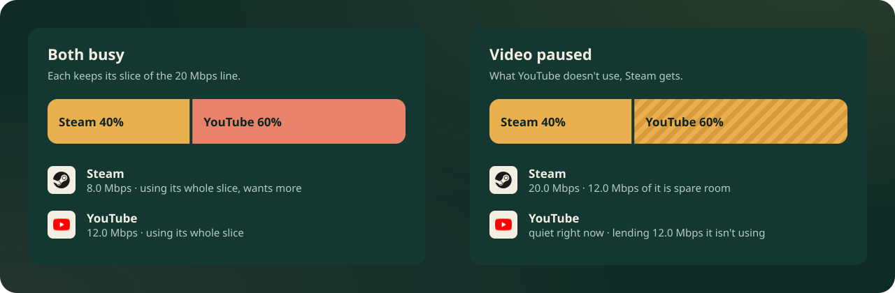

<p align="center">
  
</p>

<h1 align="center">SnailNet</h1>

<p align="center"><b>Put the bandwidth hogs in the slow lane.</b></p>

<p align="center">
  Share your Windows PC's internet between apps and websites by percentage,<br>
  so the game download and YouTube both keep going.
</p>

<p align="center">
  <a href="https://stergiosf.github.io/SnailNet/">Website</a> ·
  <a href="https://github.com/StergiosF/SnailNet/releases">Download</a> ·
  <a href="#using-snailnet">How to use it</a> ·
  <a href="#help-my-internet-broke">Help</a> ·
  <a href="#privacy">Privacy</a>
</p>

<p align="center">
  
  
  
</p>


## Why SnailNet

A game download starts and takes all your speed. The video you're
watching stops to buffer, the call breaks up, and ping jumps in the
middle of a match. Router settings are hard to find, and most bandwidth
tools make you type limits in KB/s and do the arithmetic yourself.

SnailNet lets you say it the way you think it: *the download gets 40%,
YouTube gets 60%*. It does the rest, on your PC, with no account and
nothing sent anywhere.

## What it does

- **Splits your internet by percentage.** Give each app or website a
  share. Everything you haven't named shares the rest, and always keeps
  at least 5%.
- **A share is a guarantee, never a cage.** While everyone is busy, each
  gets its share. What one doesn't use goes to whoever needs it, so none
  of your speed is wasted.
- **Works on websites, in any browser.** A rule for YouTube, Twitch or
  Netflix applies in every browser and comes before the browser's own
  share.
- **Lets games and calls go first.** The app you're using gets its
  traffic out first, a game keeps that while it runs, a voice or video
  call (in any app or browser) goes first while it lasts, and Boost lets
  one app go first for an hour, four hours or until you stop it. Going
  first only means sooner; it never makes a share bigger.
- **Keeps ping low.** It sends slightly below your internet speed, so the
  queue stays on your PC instead of in your router, and follows your
  speed as it gets faster or slower.
- **Shows it working.** While something fills your internet, SnailNet
  shows your ping next to the ping your last speed test measured without
  it: *"Ping 19 ms while Steam fills your internet"*, with 142 ms beside
  it for without. Both numbers are measured on your PC, on your network;
  when there's no difference worth showing, it doesn't claim one.
- **Switches whole setups in one click.** Four modes, plus your own copies
  of them.
- **Steps aside rather than break your internet.** If anything goes
  wrong, your traffic flows straight through. Pause stops everything in
  one click.



## Download and install

1. **Download [`SnailNet-setup.exe`](https://github.com/StergiosF/SnailNet/releases/latest/download/SnailNet-setup.exe)**
   from the [latest release](https://github.com/StergiosF/SnailNet/releases/latest).
   To hear about new ones, watch this repository (Watch → Custom →
   Releases).
2. **Run it.** The installer isn't code-signed yet, so Windows may show
   *"Windows protected your PC"*. Choose **More info**, then **Run
   anyway**. Windows asks for administrator permission once, to install
   the SnailNet service and the WinDivert driver.
3. **Tell it your speed.** On first start SnailNet offers to measure your
   connection (about 30 seconds, with Cloudflare's speed test, then a
   check of your ping with SnailNet on), or you can type the speeds a
   speed test shows. Until it knows your speed, it only
   watches.

That's it: SnailNet starts sharing your internet and sits in the tray.
The first time, it asks once whether to start with Windows.

**Needs:** Windows 10 or 11, 64-bit (x64). Not available for macOS,
Linux or ARM PCs.

## Using SnailNet

**The tray.** Click the snail in the notification area for the quick
panel: whether SnailNet is sharing your internet, the mode switch, the
apps using your internet now (each with **Boost**), your ping, **Pause**
and **Open SnailNet**. The snail itself shows how your internet is
doing: as always while it's quiet, a cream spiral while it's full and
SnailNet is sharing it, a coral shell when ping is well up anyway. Hover
it for the same in words.

**The mode switch** sits at the top of the window on every page:
**Balanced**, **Streaming**, **Gaming**, **Quiet downloads**, and any
of your own. Pick one and the whole split changes at once.

| Mode | What it does |
| --- | --- |
| **Balanced** | Every app gets a fair share. |
| **Streaming** | Videos and calls stay smooth. Downloads wait. |
| **Gaming** | Your game and voice chat come first. |
| **Quiet downloads** | Downloads never slow anything else down. |

Press **Ctrl+Alt+S** anywhere to switch to the next mode (change the
keys in Settings → Startup and keys). With *Gaming mode while you play*
on, SnailNet switches to Gaming when a game starts and back to your mode
when it closes.

**Now** (the main window's first page) answers *what's happening, and is
it OK?*

- **The sentence at the top** says it in words: *"Steam is using the
  most right now."* When one app fills your internet and leaves another
  **waiting** (Steam's download and the YouTube video that keeps
  buffering), it says so and offers the fix: **Give Brave 40%**. One
  click saves it in the current mode, **Undo** puts it back, **Not now**
  keeps quiet about those two until tomorrow. It's a button where you're
  already looking, never a pop-up; turn it off in Settings. Without a
  website share SnailNet sees the browser, not the site, so it says
  "Brave" rather than "YouTube".
- **Last 10 minutes** shows what used your internet over time, one band
  per app in the same colours as the list under it, with your speed as a
  dashed line and marks where something happened (a mode switch, a boost,
  a share given, an app that started). Hover it to read any moment;
  **Download** and **Upload** switch the chart and the list. It starts
  empty when SnailNet opens and never invents data.
- **Using your internet** lists the apps and websites moving data,
  busiest first: how fast, how each is doing ("getting all it needs",
  "waiting for speed", "Goes first · in a call") and a thin bar of its
  part of your speed. **Boost** lets one go first for a while: it gets
  at least half your speed, then everything goes back by itself. Its
  **•••** menu holds the rest: block it, mark it as a game, never let it
  go first, or change how its programs are grouped.
- **Ping** sits beside them: while something fills your internet, your
  **ping with SnailNet** next to the ping your last speed test found
  **without** it; when it's quiet, the speed test's grades from A to F.
  With no speed test on this network yet, **Measure** runs one.
- **How {mode} shares it** shows the mode's shares as one small bar, each
  with its priority, the speed it's sure of and what it uses now. **See
  the split** opens the Split page.

**Split** is where you shape it:

- **Drag** a handle on the bar at the top to trade between the two
  shares beside it (it settles on 5% steps), or use **−** and **+** on
  each row, 5% at a time. Nothing changes on your internet until
  **Save** (Ctrl+S); **Discard** throws the changes away.
- **Add an app or website** at the foot of the list (search by name).
  **Everything else** opens to its apps; one click gives an app a share
  of its own.
- Open a share for more: **Priority** (High, Normal, Low), **Only use
  spare speed** (it waits until nobody else needs the speed), a **Speed
  limit** in Mbps or %, or **Remove**.
- **Reset split** puts the mode back how it started.

**Settings** is grouped the way you'd look for things:

- **Your internet:** your speed, with **Measure** or **Change**; the
  last speed test, with a grade from A to F for how much ping rose while
  downloading, without SnailNet and with it; other networks, each with
  its own speed.
- **What goes first:** calls, the app you're using, and Gaming mode while
  you play (the first two are on by default), plus the apps you marked.
- **Apps:** how apps are grouped.
- **Startup and keys:** start with Windows, and the keys that switch
  mode.
- **Updates and About:** the version, **Check for updates**, and "Keep
  app and game lists up to date".
- **Start over:** reset one mode's split, or everything.

When a new version is out, an **Update** button appears in the side
rail; one click installs it.

### The words SnailNet uses

| Word | Means |
| --- | --- |
| **Share** | An app's or website's part of your internet, in percent. It's the least it gets while everyone is busy. |
| **Everything else** | All the apps you haven't given a share. It always keeps at least 5%. |
| **Priority** | High goes first: its traffic is sent ahead of the rest, so it stays quick. It never makes the share bigger. |
| **Only use spare speed** | It uses your internet only when nobody else wants it. |
| **Boost** | Let one app go first for a while. |
| **Your internet speed** | How fast your connection is, down and up. SnailNet shares out exactly that. |

## Questions

**If I close the window, does it stop?** No. Closing the window hides
SnailNet to the tray and your rules keep working. Right-click the tray
icon and choose **Quit SnailNet** to stop the background service too, or
use **Pause** to step aside temporarily.

**Will it make my internet slower?** It sends slightly below your
internet speed on purpose: that keeps the queue on your PC, which is what keeps
ping low while something big downloads. The cost is a sliver of top
speed.

**Does it work in every browser?** Yes. Website rules go by the site's
name, which SnailNet reads when the connection starts. A few sites hide
their names; their traffic is shown as such and still counts toward the
app's share.

**Does it work with my game's anti-cheat?** It hasn't been tested with
anti-cheat systems yet. If a game complains, pause SnailNet or stop its
service (see [Help](#help-my-internet-broke)), and please
[open an issue](https://github.com/StergiosF/SnailNet/issues).

**Does it shape uploads too?** Yes, when you give it an upload speed.
Leave either speed empty and SnailNet leaves that direction alone.

**Does it cost anything?** No. SnailNet is free and open source (GPL-3.0),
with no account and no telemetry.

## How it works

- A Windows service (`SnailNet`, runs as LocalSystem) does the work. It
  sees this PC's packets through the WinDivert driver, tells which app
  and which website each connection belongs to, and sends them out in
  the shares you set, slightly below your internet speed so the queue
  stays on your PC and not in your router.
- The app (tray icon, flyout, main window) talks to the service over a
  named pipe. Closing the window hides it to the tray while your rules
  keep working; choosing **Quit SnailNet** in the tray stops the service
  cleanly until you open SnailNet again.
- Modes switch whole sets of rules at once: Balanced, Streaming, Gaming,
  Quiet downloads, and your own copies. Ctrl+Alt+S steps through them
  (other keys in Settings → Startup and keys).

## Help, my internet broke

SnailNet is built to step aside rather than break your connection: if the
service crashes or stops, packets flow straight through again, and after
three failures in ten minutes it goes into Safe mode and leaves your
traffic alone until it's restarted. If something still seems wrong, try
these in order. Each one is enough on its own.

1. **Pause it.** Click the snail in the tray, then Pause → "Until I
   resume" (the main window's side rail has Pause too). Nothing is shaped
   or blocked while paused. If the internet comes back, a rule is the
   problem: check for a blocked app ("Using your internet" lists blocked
   apps with Unblock) or a very small share.
2. **Stop the service.** Open *Services* (Win+R, `services.msc`), find
   **SnailNet**, click Stop. Or, in a terminal run as administrator:

   ```
   net stop SnailNet
   ```

   To keep it from starting again at the next boot:
   `sc config SnailNet start= disabled` (`start= auto` undoes it).
3. **Uninstall it.** Settings → Apps → Installed apps → SnailNet →
   Uninstall. This stops and removes the service and the driver files.
   It asks whether to keep your settings in `C:\ProgramData\SnailNet`.
4. **Still nothing?** Restart the PC. The WinDivert driver is loaded only
   while SnailNet uses it, so after a restart with the service stopped or
   uninstalled, nothing of SnailNet is in the network path. If the
   internet is still down then, the cause is elsewhere.

When you report a problem, the service's logs help: they're in
`C:\ProgramData\SnailNet\logs` (one file a day, the last seven kept).

## Privacy

- **Nothing about you leaves your PC.** No telemetry, no accounts, no
  analytics.
- **What SnailNet reads, on your PC only:** which program owns each
  connection (its name, path, publisher), the addresses it talks to, and
  the *name* of the website when the connection starts (the server name
  in the TLS or QUIC hello, and the answers to DNS lookups). It never
  reads what you send or receive.
- **What it keeps:** your rules, modes, settings and measured speeds
  (`C:\ProgramData\SnailNet\config.toml`), the list of apps it has seen
  so it knows which are new (`known-apps.txt` there), and seven days of
  logs, which name apps and networks. Your hotkey and window choices are
  in your own app data folder. Uninstalling can delete all of it.
- **The only connections SnailNet makes itself:**
  - the update check, to GitHub (`github.com/StergiosF/SnailNet`
    releases), when SnailNet starts, every six hours, and when you click
    Check for updates in Settings. It only asks for the newest version
    number; nothing installs until you click the update button;
  - the website and game lists, from the same GitHub releases, once a
    day (two small downloads, checked against SnailNet's signing key
    before use; kept in `C:\ProgramData\SnailNet\packs.toml`). Turn it
    off in Settings → Updates → "Keep app and game lists up to date";
  - the speed test, to Cloudflare (`speed.cloudflare.com`), only when
    you click Measure. It downloads, uploads, then downloads once more
    with SnailNet sharing your internet, to measure your ping with it (about
    30 seconds in all; on a metered network, Settings shows a note about
    it);
  - pings to your router and to `1.1.1.1` while SnailNet is shaping
    (once a second while your internet is busy, every 30 seconds when
    it's quiet), to keep the shaping just below what it can take.

## Build

Rust (stable, MSVC) and Node (current LTS).

```powershell
cargo test --workspace
# Dev loop: the service elevated, then the app.
target\debug\snailnet-service.exe run --console
cd app; npm ci; npm run tauri dev
# The NSIS installer, signed for updates:
.\scripts\build-installer.ps1
# The README's pictures (docs/images), redrawn in the app's look:
node scripts/readme-images.cjs
# The website's link preview (site/og.png), see the script's header:
node scripts/og-image.cjs
```

The website is `site/` (plain HTML, CSS and JS), published to
<https://stergiosf.github.io/SnailNet/> by `.github/workflows/pages.yml`
on every push to `main` that changes it.

`PLAN.md` is the design and the record of every decision;
`docs/HANDOFF.md` says where the work stands.

## Licences

- **SnailNet** is free software under the GNU General Public License,
  version 3 or (at your option) any later version: see `LICENSE`
  (shipped as `licenses\SnailNet-LICENSE.txt` in the install folder).
  Copyright © 2026 Stergios Fotoglou.
- **WinDivert** 2.2.2 (driver and DLL, unmodified, loaded at run time) is
  used under the GNU LGPL v3 (it is dual-licensed LGPLv3 / GPLv2). Its
  licence ships as `licenses\WinDivert-LICENSE.txt` in the install folder,
  and its source is at
  <https://github.com/basil00/WinDivert/releases/tag/v2.2.2>.
- Everything else SnailNet ships (Rust crates, Tauri, the Atkinson
  Hyperlegible Next font) is under permissive licences (MIT, Apache-2.0,
  BSD, ISC, Zlib, Unicode, OFL) or MPL-2.0 (used unmodified).
  `licenses\THIRD-PARTY-NOTICES.txt` in the install folder lists each one
  with its licence text; `scripts\third-party-notices.ps1` makes it at
  build time, and `deny.toml` keeps the list of allowed licences.
